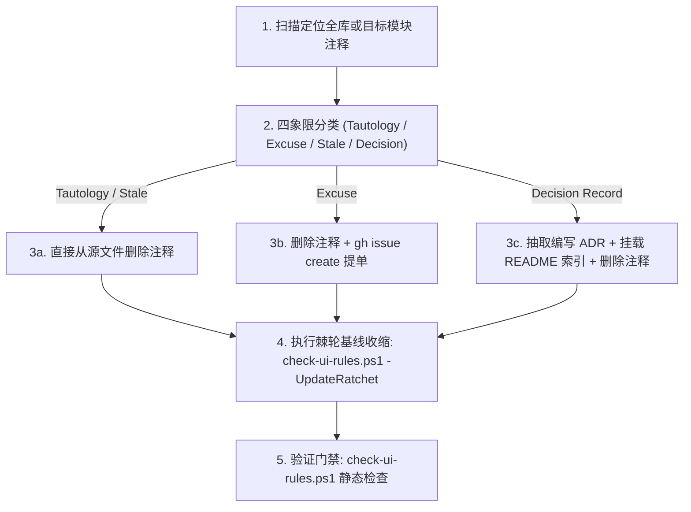

# /delete-comment — 代码注释治理与棘轮收敛工作流

本项目贯彻**「代码自解释、架构入 ADR、待办提 Issue、注释零容忍」**的工程原则。
注释往往随着代码演进而沦为陈旧信息、掩盖不良设计或诱导后续开发者继承妥协实现。
本技能定义了全库注释分类、治理与棘轮收缩的标准作业流程。

---

## 一、注释四象限分类与处置准则

对审计涉及的每一条注释，必须严格归入以下四类之一并执行指定动作：

| 类别 | 定义与判定特征 | 处置动作 |
| :--- | :--- | :--- |
| **Tautology (赘述)** | 仅用自然语言简单重复代码本身已清晰表达的意图（如字段名、方法名、显然控制流，如 `// 构造函数`、`// 点击事件`、`// 返回结果`） | **就地物理删除**。 |
| **Excuse (借口)** | 为粗糙实现、绕过 Bug、硬编码或未完成功能做辩护的文字（如 `TODO`、`FIXME`、`HACK`、`WORKAROUND`、`暂时`、`绕过`、`临时方案`、`曲线救国`） | **删除注释，并立即通过 `gh issue create` 创建追踪 Issue 推进根本治理**。 |
| **Stale (过时)** | 引用已不存在的旧类、已废弃的方法、已完成的迁移阶段或历史版本行为（如 `// 旧版分流器平移`、`// 兼容已删除的参数`） | **就地物理删除**。 |
| **Decision Record (决策)** | 记录重要、非显而易见的架构设计考量、并发不变式、容灾策略或关键设计权衡 | **抽取并沉淀为 `docs/adr/00XX-*.md`，更新 `docs/adr/README.md` 索引，并从代码中删除原注释**。 |

---

## 二、标准执行工作流 (Standard Workflow)



### 步骤 1：扫描定位注释
使用轻量脚本快速收集目标目录下的所有注释位置与文本：
```powershell
pwsh -File scripts/check-ui-rules.ps1 -Verbose
```

### 步骤 2：四象限分类审视
- 检索 `TODO|FIXME|HACK|WORKAROUND|暂时|临时|绕过`，优先筛出 **Excuse**；
- 检索长篇架构考量、并发模型与设计契约（特别是大于 5 行的复杂 KDoc），评估是否符合 **Decision Record** 升格门禁；
- 识别引用了已删除字段、已废除版本标记的内容，标记为 **Stale**；
- 其余显然描述归为 **Tautology**。

### 步骤 3：落实处置动作
1. **清理 Excuse 并提单**：
   ```bash
   gh issue create --title "<type>(<scope>): <问题描述>" --body "<背景、缺陷分析与修复诉求>" --label "bug,ready-for-agent"
   ```
2. **抽取 Decision Record 为 ADR**：
   - 查阅 `docs/adr/README.md` 取下一个顺序编号（如 `ADR-0030`）；
   - 按 ADR 标准模板（状态、上下文、候选评估、决策结论、影响）编写 `docs/adr/00XX-xxx.md`；
   - 在 `docs/adr/README.md` 表格末尾登记索引；
   - 移除源文件中的长篇注释，保持代码纯净。
3. **删除 Tautology 与 Stale**：直接编辑源文件，剥离注释行与多余空行。

### 步骤 4：收缩棘轮基线
删除注释后，必须立即通过以下命令刷新并锁定更低的注释数量与行数上限：
```powershell
pwsh -File scripts/check-ui-rules.ps1 -UpdateRatchet
```
该命令会自动扫描全库 Kotlin 源码并将新的统计值持久化到 `scripts/comment-ratchet.json`，确保后续开发**只降不升**。

### 步骤 5：门禁验证
运行静态规则扫描器，确保 0 错误：
```powershell
pwsh -File scripts/check-ui-rules.ps1
```

---

## 三、提交与交付规范 (Commit Guidelines)

- **Commit 信息规范**：Conventional Commits 1.0.0，全中文、无末尾句号：
  ```
  chore(clean): 删除 <模块名> 存量代码注释并收缩棘轮基线
  ```
- **PR 描述要求**：
  - 明确列出本次清理删除的注释总数与总行数；
  - 附带创建的 GitHub Issue 链接（如 `关联修复任务：#215, #216`）；
  - 附带新建的 ADR 编号与标题（如 `架构沉淀：ADR-0028, ADR-0029`）；
  - 确认 `scripts/comment-ratchet.json` 已同 PR 提交锁定。
